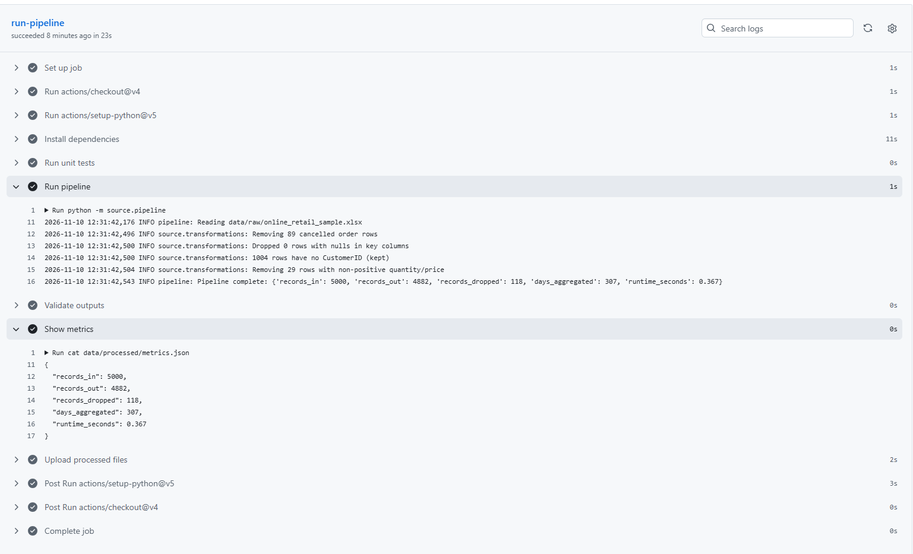
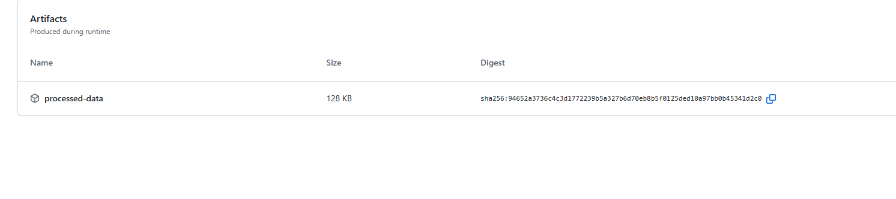
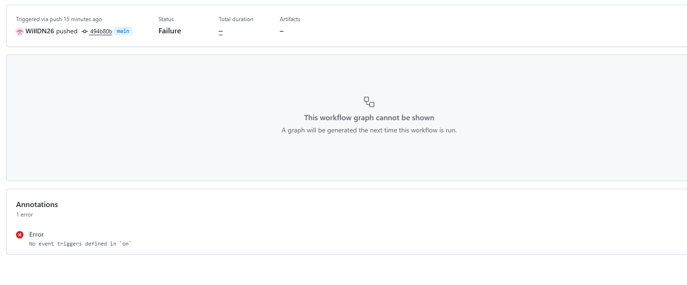

# Online Retail Data Pipeline

A small, end-to-end data pipeline built in Python. It ingests an Excel export of online retail transactions, cleans and enriches the data, aggregates daily sales, and writes the results to CSV and Parquet. The pipeline is versioned in Git, tested with pytest, and run automatically by GitHub Actions on every push.

**Dataset:** [Online Retail dataset (Kaggle)](https://www.kaggle.com/datasets/lakshmi25npathi/online-retail-dataset)

## Architecture

```
Excel sample (data/raw)
        |
        v
  Ingest (pandas.read_excel)
        |
        v
  Rename columns + validate schema
        |
        v
  Clean: remove cancelled orders -> handle nulls -> convert types -> remove invalid values
        |
        v
  Enrich: TotalPrice = Quantity x UnitPrice
        |
        v
  Aggregate: daily sales totals
        |
        v
  Output: CSV + Parquet + metrics.json (data/processed)
        |
        v
  GitHub Actions: tests -> pipeline -> output validation -> upload build artifact
```

## Repository structure

```
online-retail-pipeline/
├── .github/workflows/pipeline.yml   # CI workflow
├── data/
│   ├── raw/online_retail_sample.xlsx   # 5,000-row sample of the dataset
│   └── processed/                      # pipeline outputs
├── source/
│   ├── __init__.py
│   ├── transformations.py              # cleaning, enrichment and aggregation functions
│   └── pipeline.py                     # entry point: orchestration, logging, metrics
├── tests/
│   ├── test_transforms.py              # pytest unit tests for the transformation functions
│   └── validate_outputs.py             # post-run checks on the output files
├── make_sample.py                      # creates the sample from the full Kaggle file
├── requirements.txt
└── README.md
```

## Setup and usage

Requires Python 3.12 (other recent versions should also work).

```powershell
# 1. Install dependencies
py -m pip install -r requirements.txt

# 2. (Optional) Recreate the sample from the full Kaggle file
#    Place the downloaded "Online Retail.xlsx" in the project root first.
py make_sample.py

# 3. Run the pipeline from the project root
py -m source.pipeline

# 4. Run the unit tests
py -m pytest -v

# 5. Validate the outputs
py tests/validate_outputs.py
```

The pipeline accepts optional arguments:

```powershell
py -m source.pipeline --input "path/to/file.xlsx" --output "path/to/output_folder"
```

### About the sample

The full dataset has roughly 540,000 rows, which is large to commit and slow to run in CI. `make_sample.py` takes a random sample of 5,000 rows (`random_state=42`, so it is reproducible) and saves it to `data/raw/`. The full file is excluded from Git through `.gitignore`. Because the sample is random, some invoices are split across the sample and appear incomplete. This does not affect the pipeline's results for this project.

## Pipeline stages and cleaning rules

| Stage | Function | What it does and why |
|---|---|---|
| Rename | `rename_columns` | The Kaggle file uses the column names `Invoice`, `Price` and `Customer ID`. These are renamed to `InvoiceNo`, `UnitPrice` and `CustomerID` so the rest of the code uses one consistent schema. |
| Validate | `validate_schema` | Raises a clear error if any required column is missing, so schema changes fail early rather than producing wrong output. |
| Remove cancelled orders | `remove_cancelled` | Invoice numbers starting with `C` are cancellations, so they are excluded from sales. |
| Handle nulls | `handle_nulls` | Rows missing an invoice number, date, quantity or price are dropped. Missing descriptions are set to `UNKNOWN`. Rows with no `CustomerID` are kept, because they are still valid sales and are only excluded from customer-level analysis. |
| Convert types | `convert_types` | Dates become datetimes, quantity and price become numbers, `CustomerID` becomes a nullable integer. Rows that cannot be converted are logged and dropped. |
| Remove invalid values | `remove_invalid_values` | Rows with zero or negative quantity or price (for example stock adjustments) are not real sales and are removed. |
| Enrich | `add_total_price` | Adds `TotalPrice = Quantity x UnitPrice`. |
| Aggregate | `daily_sales` | Groups by day and calculates `total_sales`, `orders` (distinct invoices) and `units_sold`. |

### Outputs (`data/processed/`)

| File | Contents |
|---|---|
| `clean_orders.csv` | Cleaned, enriched row-level data including `TotalPrice` |
| `daily_sales.csv` | Daily totals: `SaleDate`, `total_sales`, `orders`, `units_sold` |
| `daily_sales.parquet` | The same daily totals in Parquet format |
| `metrics.json` | Processing metrics for the latest run |

## Testing

Unit tests in `tests/test_transforms.py` cover each transformation function using a small hand-built DataFrame:

- cancelled orders are removed
- null descriptions are filled
- types are converted correctly
- invalid quantities and prices are removed
- `TotalPrice` is calculated correctly
- daily sales are aggregated correctly
- a missing column raises a `ValueError`

All 7 tests pass. `tests/validate_outputs.py` is a separate check that runs after the pipeline. It confirms that all four output files exist, daily sales are not empty or non-positive, no cancelled invoices remain, there are no duplicate dates, and at least one record was processed. It exits with a non-zero code on failure so that the CI run fails.

## CI/CD (GitHub Actions)

The workflow in `.github/workflows/pipeline.yml` runs on every push and pull request. Its steps, in order:

1. **Check out** the repository.
2. **Set up Python 3.12** with pip caching.
3. **Install dependencies** from `requirements.txt`.
4. **Run unit tests** with pytest.
5. **Run the pipeline** on the committed sample.
6. **Validate outputs** with `tests/validate_outputs.py`.
7. **Show metrics** by printing `metrics.json` to the log.
8. **Upload** `data/processed/` as a build artifact named `processed-data`.

The steps are ordered so that problems fail as early as possible, and the artifact is only uploaded if everything before it passed.





## Monitoring and observability

- **Logging:** Python's `logging` module records each stage with a timestamp. Examples: how many cancelled rows were removed, how many rows had null values, and how many rows had no `CustomerID`. Errors are logged with a full traceback, and the program exits with a non-zero code so a failure is visible in CI.
- **Metrics:** each run writes `metrics.json`. The latest run on the sample produced:

```json
{
  "records_in": 5000,
  "records_out": 4882,
  "records_dropped": 118,
  "days_aggregated": 307,
  "runtime_seconds": 2.381
}
```

- **Data quality in the latest run:** 89 cancelled rows were removed, 0 rows were dropped for nulls in key columns, 1,004 rows had no `CustomerID` (kept), and 29 rows had a non-positive quantity or price and were removed. That accounts for the 118 dropped records (89 + 29).
- **Workflow logs:** the Actions tab on GitHub shows each step's output and timing, the printed metrics, and the downloadable artifact, which lets me check pipeline health on every push.


## Reflection

### What went wrong and how I fixed it

- **Schema mismatch:** the pipeline stopped with an error saying `CustomerID`, `InvoiceNo` and `UnitPrice` were missing. The schema validation caught this. I checked the real column names in the file, found the dataset uses `Invoice`, `Price` and `Customer ID`, and added a rename step.
- **Missing library:** writing the Parquet file failed because `pyarrow` was not installed. The error was clear, and I added `pyarrow` to `requirements.txt` so that CI installs it too.
- **Module name mismatch:** an import failed because my file was named `transformations.py` but the code imported `transforms`. I renamed the file so the names matched.
- **Workflow failure:** the first GitHub Actions run failed with "No event triggers defined in `on`". The trigger section of the YAML had been malformed, so I rewrote it in a simpler form, pushed the fix, and the run passed.



### What I learned

This was a really helpful challenge for me specifically with my use of Git. As I don't regularly use Git, doing a small project based around it is really useful. All of the code was written with AI but I did check and validate it to double check I was happy with all the transformations.

### What I would improve

- Process the full dataset instead of a sample, possibly loading it in chunks.
- Make the pipeline incremental so that it only processes new data on each run.
- Add automated data quality checks with a library such as Great Expectations.
- Handle both sheets of the Excel file if the source has more than one year of data.
- Load the output into a database or data warehouse and schedule the run, instead of only producing files.
- Add a test for `rename_columns` and for the full pipeline run.